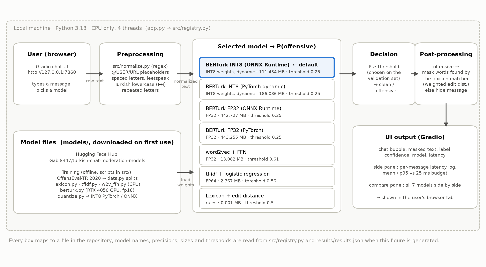
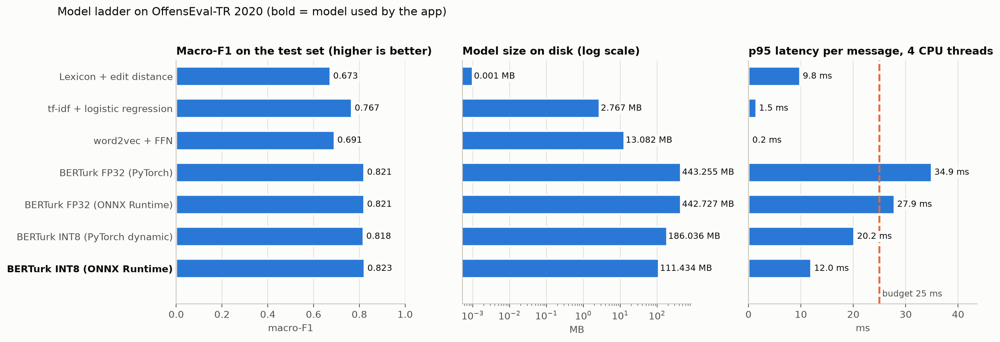
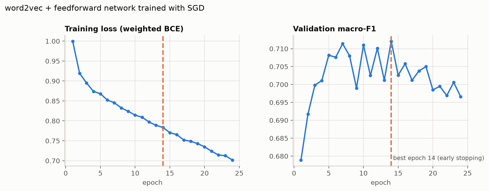

# Real-Time Turkish Chat Moderation

**SWE015 – Introduction to Large Language Models · Individual homework · Use Case 4 (Real-Time Chat Moderation)**

A gaming platform must flag offensive Turkish chat messages within a strict time limit on a
CPU-only server. This repository solves the task with a ladder of four model families –
a classical baseline, a neural network trained from scratch, a fine-tuned Transformer and a
quantized Transformer – compares them on the same held-out test set, and ships the quantized
model inside a live chat application.

- Model files: [huggingface.co/Gabi8347/turkish-chat-moderation-models](https://huggingface.co/Gabi8347/turkish-chat-moderation-models) (downloaded automatically)
- Data: OffensEval-TR 2020 (Çöltekin, 2020) – downloaded automatically from the original source

## Quick start

Tested with **Python 3.13** on Windows 11; the app needs only a CPU.

```bash
git clone https://github.com/Gabi8347/turkish-chat-moderation.git
cd turkish-chat-moderation
python -m venv .venv
.venv\Scripts\activate            # Windows   (macOS / Linux: source .venv/bin/activate)
pip install -r requirements.txt
```

> **Windows:** clone into a short path (e.g. `C:\dev\`). PyTorch contains very long file
> paths; in a deeply nested folder `pip install` fails with `OSError: [Errno 2]` unless
> [Windows long-path support](https://pip.pypa.io/warnings/enable-long-paths) is enabled.

**Run the application (single command):**

```bash
python app.py
```

Open http://127.0.0.1:7860. On the first start the default model (≈ 111 MB) is downloaded
from the Hugging Face Hub; other models are downloaded when you select them.

## The application

- a chat box: every message is labeled live **clean / offensive** with a confidence score
- offensive messages are **masked** – words found by the lexicon matcher are starred out
  (`s.i.k.t.i.r git` → `s********** git`); if the model flags a message without any lexicon word,
  the whole message is hidden
- a side panel logs the **response time of every message** with mean / p95 against the latency budget
- a **model switch** between all seven models (default: quantized BERTurk INT8 on ONNX Runtime)
- a **compare panel** that runs one message through every model side by side

## Architecture



The figure is generated by `python -m src.figures` from `src/registry.py` (the models the app
can load) and `results/results.json` (their precision, size and threshold), so it stays in
sync with the code.

| Step | File | What happens |
|---|---|---|
| User interface | `app.py` | Gradio chat UI, latency panel, model switch, compare panel |
| Preprocessing | `src/normalize.py` | regex normalization: `@USER`/URL placeholders, spaced letters (`s.i.k` → `sik`), leetspeak (`gelm3ye` → `gelmeye`), Turkish lowercasing (I → ı, İ → i), repeated letters (`çoooook` → `çok`) |
| Model | `src/registry.py` → one of the seven models below | P(offensive) for the normalized message |
| Decision | `src/registry.py` | P ≥ threshold (each model's threshold was chosen on the validation set) |
| Post-processing | `app.py`, `src/lexicon.py` | mask lexicon words, or hide the message |
| Where it runs | – | local machine, CPU only, 4 threads; weights from the Hugging Face Hub |

## Technique map

| Area | Technique | Where |
|---|---|---|
| **A · Neural networks** | feedforward network (200 → 128 → 64 → 1), ReLU, dropout, mini-batch **SGD + backpropagation**, early stopping | `src/w2v_ffn.py` |
| **B · Classical NLP** | regular expressions (normalization, leetspeak), tokenization, **weighted minimum edit distance** lexicon matcher, **tf-idf** (word + character n-grams) + logistic regression, own **word2vec** (skip-gram) | `src/normalize.py`, `src/lexicon.py`, `src/tfidf.py`, `src/w2v_ffn.py` |
| **C · Transformers** | **BERTurk** (`dbmdz/bert-base-turkish-cased`, WordPiece) fine-tuned with a classification head | `src/berturk.py` |
| **D · Efficient models** | post-training **dynamic INT8 quantization** (PyTorch and ONNX Runtime), ONNX export, benchmarking of size / latency / accuracy against a latency budget | `src/quantize.py`, `src/evaluate.py` |

## Data

[OffensEval-TR 2020](https://coltekin.github.io/offensive-turkish/) – Turkish tweets labeled
NOT (clean) / OFF (offensive). `python -m src.data` downloads it and builds fixed splits:

| Split | Tweets | Offensive | Source |
|---|---|---|---|
| train | 28,580 | 19.3 % | official training set, stratified 90 % (seed 42) |
| val | 3,176 | 19.3 % | official training set, stratified 10 % – model selection and thresholds only |
| test | 3,528 | 20.3 % | official test set with gold labels – used once per model |

## The four models

1. **Classical baseline** – tf-idf (word 1–2-grams + character 2–5-grams, 163,851 features) +
   logistic regression with balanced class weights; C = 1 chosen on val.
   A rule baseline is reported as well: a hand-written lexicon of 76 Turkish offensive words
   matched with a weighted edit distance where masking symbols and leetspeak digits cost 0.
2. **Neural network** – word2vec (skip-gram, 100 dimensions, 29,736 words) trained from scratch on
   the training tweets; each message is the [mean ; max] of its word vectors; a feedforward network
   (34,049 parameters) trained with SGD (momentum 0.9) and backpropagation; best epoch 14 of 24.
3. **Transformer** – BERTurk fine-tuned for 3 epochs (AdamW, lr 2e-5, batch 32, warm-up 10 %,
   fp16 on an RTX 4050 Laptop GPU, ≈ 7 min); best epoch 2 (val macro-F1 0.839).
4. **Quantized Transformer** – the fine-tuned BERTurk with dynamic INT8 quantization of all
   linear layers, (a) in PyTorch and (b) in ONNX Runtime after ONNX export. No retraining, no
   calibration; the FP32 validation threshold is reused.

## Results

Latency budget (Use Case 4): **p95 ≤ 25 ms per message on 4 CPU threads** – a moderation server
shares its cores between many chats. All models are evaluated on the same official test set,
one message at a time, exactly as in the application.

Official OffensEval-TR 2020 test set (3,528 tweets). Latency: one message at a time, mean / p95 over 200 runs, 13th Gen Intel(R) Core(TM) i7-13650HX, CPU only, 4 threads, Windows 11. Budget: p95 ≤ 25 ms.

| Model | Rung | Precision | Macro-F1 | F1 (offensive) | Size (MB) | Latency mean (ms) | Latency p95 (ms) | Budget |
|---|---|---|---|---|---|---|---|---|
| Lexicon + edit distance | classical (rules) | n/a | 0.673 | 0.434 | 0.001 | 4.04 | 9.83 | ✅ |
| tf-idf + logistic regression | classical baseline | fp64 | 0.767 | 0.626 | 2.767 | 1.51 | 1.48 | ✅ |
| word2vec + FFN | neural network | fp32 | 0.691 | 0.507 | 13.082 | 0.13 | 0.20 | ✅ |
| BERTurk FP32 (PyTorch) | Transformer | fp32 | 0.821 | 0.718 | 443.255 | 20.16 | 34.95 | ❌ |
| BERTurk FP32 (ONNX Runtime) | Transformer | fp32 | 0.821 | 0.718 | 442.727 | 16.74 | 27.85 | ❌ |
| BERTurk INT8 (PyTorch dynamic) | quantized Transformer | int8 weights (dynamic), fp32 activations | 0.818 | 0.711 | 186.036 | 14.16 | 20.20 | ✅ |
| **BERTurk INT8 (ONNX Runtime)** (app default) | quantized Transformer | int8 weights (dynamic), fp32 activations | 0.823 | 0.719 | 111.434 | 6.97 | 11.99 | ✅ |



**What the comparison shows**

- BERTurk is the most accurate model (macro-F1 0.821 vs. 0.767 for tf-idf), but in FP32 it
  misses the latency budget (p95 34.9 ms).
- Dynamic INT8 quantization on ONNX Runtime keeps the accuracy (0.823 – the small difference to
  FP32 is quantization noise; 46 of 3,528 test labels change) at **4× smaller size and 2.9× lower
  p95 latency**, well inside the budget. PyTorch INT8 is slower and larger because it keeps the
  32,000 × 768 word-embedding table in FP32, which ONNX Runtime quantizes too.
- The word2vec + FFN does not beat tf-idf: pooling word vectors discards word order and the
  embeddings are learned from only 28k tweets, while character n-grams capture Turkish suffixes
  and spelling variants directly. It is, however, the fastest model.
- The lexicon matcher is precise but misses most offensive tweets (F1 offensive 0.434) – many
  insults contain no swear word.



**Limitations**

- The data are tweets, not game chat; the annotation is noisy (some swear words are labeled clean).
- **Failure example:** `4mk bu ne biçim oyun ya` ("4mk" = leetspeak for the swear word "amk") is
  labeled **clean** by the deployed BERTurk INT8 model (P(offensive) = 0.04), although the lexicon
  matcher finds "amk" in it – the digit-for-letter spelling is rare in the training tweets.
- Sarcasm and insults without offensive words are often missed by every model.
- Dynamic quantization scales activations per call, so INT8 results depend on how messages are
  batched; PyTorch INT8 results also vary slightly with the CPU thread count.
- `#yaşasın1mayıs` → `yaşasınimayıs`: the leetspeak rule can change real digits inside words.

## Reproducing the results

All numbers above come from these scripts (run from the repository root, in this order).
Training BERTurk expects a CUDA GPU; everything else runs on a CPU.

```bash
python -m src.data          # download OffensEval-TR 2020, build splits
python -m src.lexicon       # rule baseline
python -m src.tfidf         # tf-idf + logistic regression
python -m src.w2v_ffn       # word2vec + feedforward network
python -m src.berturk       # fine-tune BERTurk (GPU), evaluate FP32 on CPU
python -m src.quantize      # PyTorch INT8, ONNX FP32, ONNX INT8
python -m src.figures       # results table and figures in docs/
```

Results are written to `results/results.json` and `results/predictions/`.

## Repository layout

```
app.py                     Gradio application
src/normalize.py           regex normalization (area B)
src/data.py                dataset download and splits
src/lexicon.py             weighted edit-distance lexicon matcher (area B)
src/tfidf.py               tf-idf + logistic regression (area B)
src/w2v_ffn.py             word2vec + feedforward network (areas A, B)
src/berturk.py             BERTurk fine-tuning (area C)
src/quantize.py            INT8 quantization, ONNX (area D)
src/evaluate.py            shared metrics, size and latency benchmark
src/registry.py            models available in the app, Hugging Face download
src/figures.py             results table and figures
resources/                 offensive-word lexicon
results/                   metrics, predictions, training logs
docs/                      figures and results table
```

## AI usage

AI coding assistance (Claude Code) was used for writing and debugging code and for drafting
documentation. All numbers in this repository come from my own runs of the scripts above.

## References

- Ç. Çöltekin. *A Corpus of Turkish Offensive Language on Social Media.* LREC 2020.
- S. Schweter. *BERTurk – BERT models for Turkish* (`dbmdz/bert-base-turkish-cased`), 2020.
- L. Tunstall, L. von Werra, T. Wolf. *Natural Language Processing with Transformers.* O'Reilly, 2022 (Ch. 8, efficient transformers).
- D. Jurafsky, J. H. Martin. *Speech and Language Processing*, 3rd ed. draft (Ch. 2 edit distance, Ch. 6 word2vec).
- T. Mikolov et al. *Distributed Representations of Words and Phrases and their Compositionality.* NeurIPS 2013.
- J. Devlin et al. *BERT: Pre-training of Deep Bidirectional Transformers for Language Understanding.* NAACL 2019.
